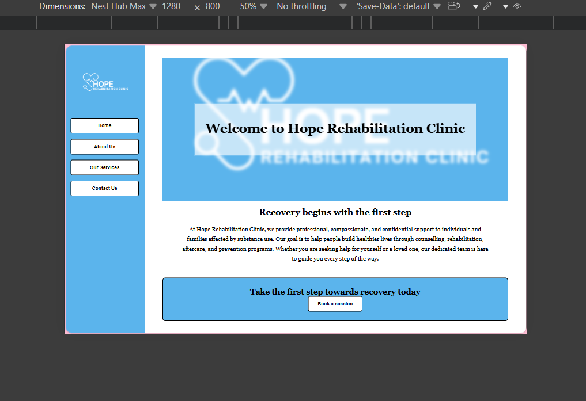
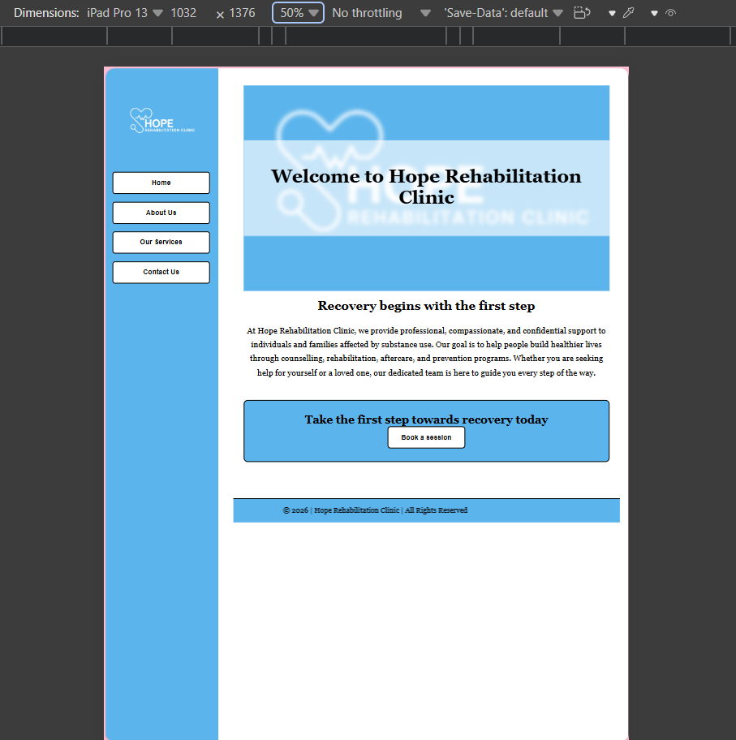

# Hope Rehabilitation Clinic

## Project description
# This website was created for Hope Rehabilitation Clinic to provide information about the clinic, its services, and contact details.
The website contains five pages:
* Home
* About us
* Our services
* Contact us
* Inquiry form

## Part 2 - CSS styling and responsive design

# For Part 2, the website was improved using:
* External CSS stylesheets
* Formal typography
* Consistent colours and styling
* Fixed navigation
* Hover effects
* CSS animations
* Flexbox layout
* Responsive design using media queries
* Responsive images
* Improved form validation

## Part 3 - JavaScript enhancements and website optimisation

* For Part 3, the website was enhanced with JavaScript functionality and search engine optimisation
* JavaScript functionality, including live search, FAQ accordion and contact form validation
* SEO improvements, including keywords, metadata, internal linking, sitemap and robots.txt
* Performance optimisation through image checks, lazy loading and Lighthouse testing
* Accessibility and security improvements, including form labels, keyboard navigation and secure external links
* Local SEO through location information, an embedded map and social media links
* Responsive testing across desktop, tablet and mobile devices

## The website was tested on:
# Desktop
# Tablet
# Mobile

Screenshots of the different screen sizes are included below.

### Desktop

### Tablet

### Mobile

## Technologies used
* HTML5
* CSS3
* JavaScript
* Flexbox
* CSS Grid
* Media Queries
* CSS Animations
* Google Lighthouse

### Search Engine Optimisation (SEO)

Search Engine Optimisation (SEO) is the process of improving a website's visibility in search engine results to attract more visitors through keyword research, optimised page titles and meta descriptions, proper heading structure, image alt text, internal linking, sitemaps, robots.txt files and local SEO, all of which were implemented on the Hope Rehabilitation Clinic website.

### References
* MDN Web Docs
* W3Schools
* Google Lighthouse
